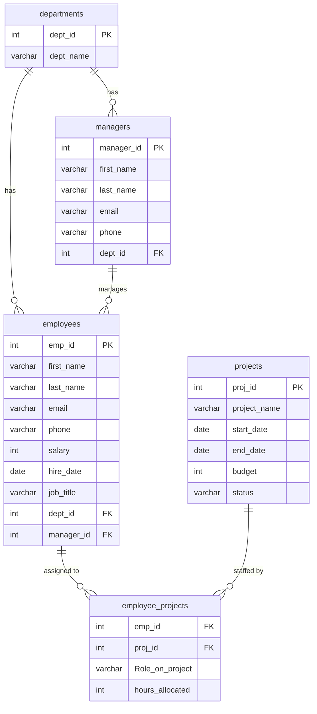

# Company Employee & Project Database (SQL Server)

A relational database for a fictional tech company, built in Microsoft SQL Server (T-SQL). It tracks employees, departments, managers, projects, and which employees work on which projects. I built it to practice database design, data cleaning, and business-focused analysis with SQL.

## Project Goals

- Design a normalized relational schema with primary keys, foreign keys, and constraints
- Generate realistic, slightly messy data and clean it
- Answer business questions using joins, CTEs, window functions, and aggregations

## Database Schema



`employee_projects` is a junction table that resolves the many-to-many relationship between employees and projects.

### Dataset size

| Table | Rows |
|-------|------|
| departments | 6 |
| managers | 6 |
| employees | ~110 |
| projects | 25 |
| employee_projects | see `03_queries.sql` for current count |

### Constraints

- Primary keys on every table
- Foreign keys linking employees, managers, projects, and departments
- `CHECK (salary > 0)`
- `CHECK (hours_allocated BETWEEN 1 AND 40)`
- `CHECK` on project status: `Planned`, `In Progress`, `Completed`, `On Hold`
- `CHECK (end_date >= start_date)` on projects
- `UNIQUE` on employee email

## Repository Structure

```
├── README.md
├── 01_create_tables.sql     # Schema: tables, keys, constraints
├── 02_insert_data.sql       # Sample data (generated, then exported)
├── 03_queries.sql           # 10 business questions with solutions
└── images/
    └── er_diagram.png       # ER diagram exported from SSMS or dbdiagram.io
```

## How to Run

1. Install SQL Server and SQL Server Management Studio (SSMS).
2. Create an empty database: `CREATE DATABASE MyDatabase;`
3. Run the scripts in order: `01_create_tables.sql`, then `02_insert_data.sql`.
4. Run any query from `03_queries.sql`.


## Data Generation

The first 10 employees and 10 projects were entered by hand. I then scaled the dataset up with T-SQL:

- Random names, departments, and salaries built with `NEWID()` and `CHECKSUM()` (used instead of `RAND()`, which returns the same value for every row in a query)
- About 10% of phone numbers left as `NULL` to simulate missing data
- Each employee assigned the manager of their department
- Project dates, budgets, statuses, roles, and weekly hours filled in with explicit values so the data is the same on every run

Assumption: `hours_allocated` is the number of hours per week an employee spends on a project.

## Data Quality Issues Found and Fixed

| Issue | Fix |
|-------|-----|
| `salary` stored as `VARCHAR` with commas (`86,000`), so `AVG()` failed | Removed the commas and converted the column to `INT` |
| Inconsistent email formats (initials vs. `firstname.lastname`) | Standardized to `firstname.lastname@tech.space.ac.ke`, with a number added for duplicate names, then added a `UNIQUE` constraint |
| Malformed email domain (`.a.ke` instead of `.ac.ke`) | Corrected with `UPDATE` |
| Typo in department name (`Procument`) | Corrected to `Procurement` |
| `hours_allocated` created as `DATE` instead of `INT` | Dropped and recreated the column with the right type |
| Inconsistent table naming (singular, plural, camelCase) | Renamed with `sp_rename` to plural snake_case |

## Business Questions Answered

All queries are in `03_queries.sql`.

| # | Question | SQL concepts |
|---|----------|--------------|
| 1 | Headcount and average salary by department | `JOIN`, `GROUP BY` |
| 2 | Employees earning more than their department average | CTE, `JOIN` |
| 3 | Top 3 highest-paid employees per department | `DENSE_RANK()` |
| 4 | Projects with no employees assigned | `LEFT JOIN`, `IS NULL` |
| 5 | Employees overallocated (over 40 hours/week) | `GROUP BY`, `HAVING` |
| 6 | Budget per team member for each project | `LEFT JOIN`, `NULLIF` |
| 7 | Manager with the largest team | Aggregation |
| 8 | Average tenure by department | `DATEDIFF` |
| 9 | Hires per year with running total | CTE, window `SUM()` |
| 10 | Employees on multiple projects | `STRING_AGG`, `HAVING` |

## Key Findings

- **Salary:** HR department has the highest average salary at 104300, while QA department has the lowest at 78318.
- **Workload:** 68 employees are allocated more than 40 hours per week across projects, which would flag a resourcing risk.
- **Projects:** 2 projects have no staff assigned, and 12 are currently In Progress.
- **Management:** Malika Janet leads the largest team with 25 direct reports.
- **Tenure:** Average employee tenure is 6 years, with QA department the longest at 6.8 years.

## Possible Improvements

- Merge `managers` into `employees` using a self-referencing `manager_id`, so managers are employees too
- Add views for common reports (for example, project staffing summary)
- Add a stored procedure that returns a department's employees and projects
- Add indexes on foreign key columns and compare query performance
- Build a Power BI dashboard connected to the database

## Tools

- Microsoft SQL Server
- SQL Server Management Studio (SSMS)
- T-SQL

## Author

Roseline Atieno | alangoroseline@gmail.com

